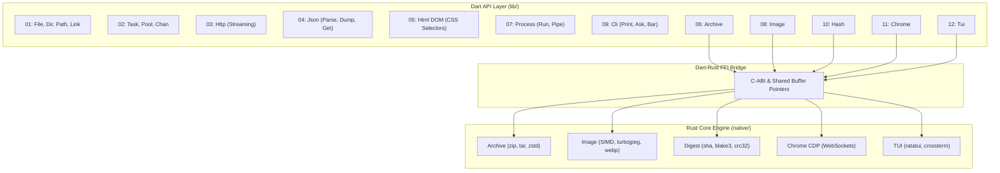

# 13: Implementation Plan (Option B)

Step-by-step roadmap to implement the Option B architecture: **Rust Core Engine + Ergonomic Dart Wrapper**.

---

## Architecture Overview

---

## Phase 1: Clean Up & Deprecation

Remove legacy and over-engineered modules from the existing codebase:
- [x] Delete old proposal files.
- [ ] Remove `lib/xml.dart`, `lib/xpath.dart`, and `lib/src/formats/xml/*`.
- [ ] Remove `lib/src/formats/yaml.dart`, `toml.dart`.
- [ ] Remove `Table` and `Matrix` abstractions from `lib/collection.dart`.
- [ ] Remove legacy `lib/torrent.dart` and `lib/tui/*`.

---

## Phase 2: Base Traits & I/O Primitives (`lib/`)

Establish the foundational interfaces that enable seamless piping across modules:
1. **Base Interfaces**:
   - Define `Reader`, `Writer`, `Seeker`, `Closer`.
   - Implement universal `pipe(Reader src, Writer dst)`.
2. **Filesystem & Path**:
   - `File`: Implements `Reader` & `Writer`, `text()`, `bytes()`, `write()`, `atomic()`.
   - `Dir`: `make()`, `drop()`, `find()`, `watch()`.
   - `Path`: Operator `/`, `isLink`, `target`, safe sandbox traversal.
   - `Link`: Symlink and hardlink operations.

---

## Phase 3: Concurrency & Core Formats (`lib/`)

1. **Async & Concurrency**:
   - `Task`: One-shot background isolate execution with timeout and cancellation.
   - `Pool`: Persistent worker isolate pool with reusable workers.
   - `Chan`: Bounded MPSC channels (`cap`, `send`, `recv`, `close`) for backpressure and fan-in.
2. **Data Formats**:
   - `Json`: Fast `parse()`, `dump()`, safe path `get('a.b.c')`, streaming JSONL.
   - `Html`: Lightweight DOM parser with 1-word CSS queries (`find`, `all`, `text`, `attr`, `drop`).

---

## Phase 4: Networking & Process Pipelines (`lib/`)

1. **HTTP Client**:
   - `Http.get()`, `Http.post()` returning `Resp` implementing `Reader`.
   - Native parsing helpers: `.text()`, `.json()`, `.html()`.
   - Streaming downloads with progress callbacks, chunked uploads, and `Range` resume.
2. **Subprocess Pipelines**:
   - `Process.run()` with exit code and stdout/stderr capture.
   - Pipeline chaining: `proc1.pipe(proc2)` and `proc.pipe(file)`.
   - Process tree termination on timeout.

---

## Phase 5: Rust Core Upgrades (`native/`)

Expand and optimize the existing Rust crate:
1. **Native Digest & Archive**:
   - Verify zero-copy buffer views for `sha256`, `blake3`, `crc32`.
   - Streaming archive decompression directly to memory/callback for `tar`, `zip`, `zstd`.
2. **Native Image Engine**:
   - Fast SIMD resizing, cropping, and format conversion (`turbojpeg`, `webp`, `png`).
3. **Chrome CDP Engine**:
   - Integrate native WebSocket CDP client (`chromiumoxide` / `tungstenite`).
   - Export FFI functions: `launch`, `navigate`, `screenshot`, `pdf`, `eval`.
4. **TUI Terminal Engine**:
   - Integrate `ratatui` + `crossterm`.
   - Export double-buffered frame diff renderer, raw mode hooks, and non-blocking event polling.

---

## Phase 6: Dart High-Level Wrappers

Implement the 1-word ergonomic Dart wrappers for native subsystems:
1. **`Hash`**: `Hash.sha256(data)`, `Hash.blake3(data)`, `Hex`, `Base64`.
2. **`Archive`**: `Archive.pack(src, dst)`, `Archive.unpack(src, dst)`.
3. **`Image`**: `Image.load()`, `fit()`, `crop()`, `save()`.
4. **`Chrome`**: `Chrome.launch()`, `page.open()`, `page.shot()`, `page.pdf()`, `page.click()`.
5. **`Tui`**: `Tui.run()`, `term.draw()`, `term.poll()`.
6. **`Cli`**: Colors, `ask()`, `confirm()`, `bar()`, `spin()`.

---

## Phase 7: Verification & Benchmarks

1. **End-to-End Integration Tests**:
   - Run full web crawling pipeline (Pool + Chan + Http + Html + File).
   - Run stream unpack & thumbnail generation pipeline (Http -> Archive -> Image).
   - Test Chrome headless scraping & PDF generation.
   - Test interactive TUI event loop.
2. **Performance Benchmarking**:
   - Validate throughput against baseline.
   - Ensure zero memory leaks across the FFI boundary.
